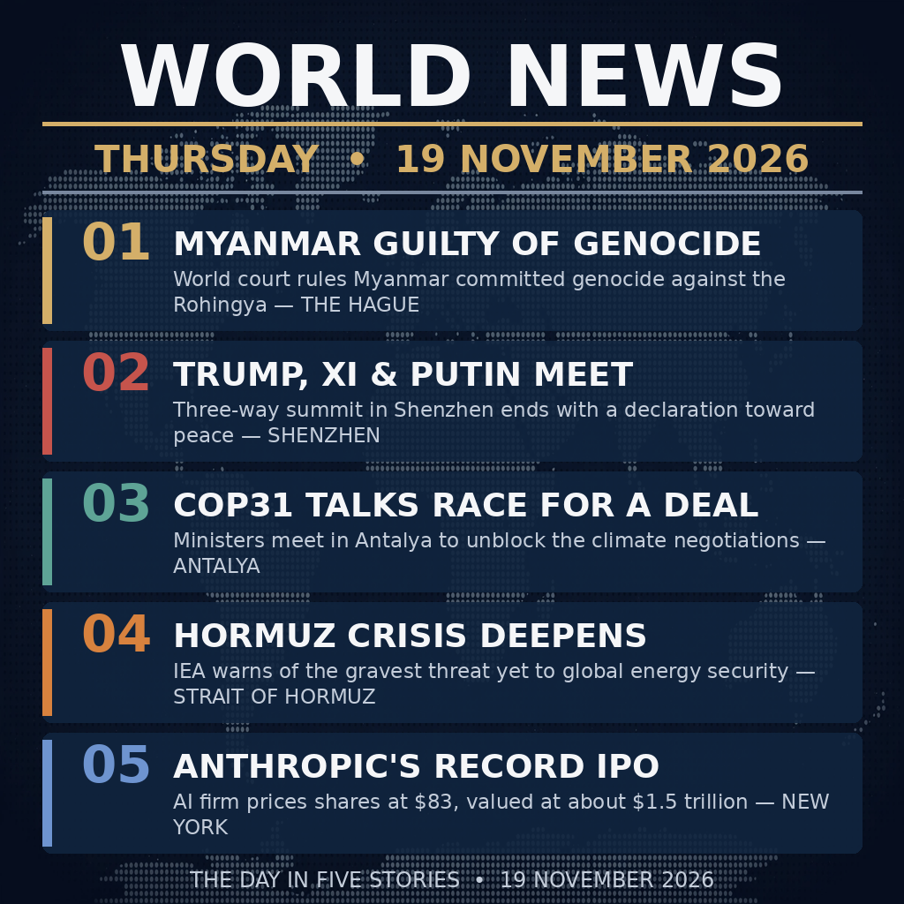

[](https://make.fun/bounty/news-image-20261119)
[](https://make.fun/bounty/news-image-20261119)
[](https://make.fun/bounty/news-image-20261119)

# The day in five stories — 19 November 2026

One image summing up the world's news of Thursday 19 November 2026, for the
[make.fun bounty](https://make.fun/bounty/news-image-20261119) of the same name.



A newspaper front page: the masthead names the day, then the five biggest
stories, each with a headline, one factual subline and its dateline.

1. **Myanmar guilty of genocide** — the world court rules Myanmar committed
   genocide against the Rohingya (The Hague)
2. **Trump, Xi & Putin meet** — three-way summit in Shenzhen ends with a
   declaration toward peace (Shenzhen)
3. **COP31 talks race for a deal** — ministers meet in Antalya to unblock the
   climate negotiations (Antalya)
4. **Hormuz crisis deepens** — IEA warns of the gravest threat yet to global
   energy security (Strait of Hormuz)
5. **Anthropic's record IPO** — AI firm prices shares at $83, valued at about
   $1.5 trillion (New York)

## How it was built

The background (a dark dotted world map, no text) is AI-generated; every word
on the image is drawn with PIL by `scripts/compose.py`, so the letters stay
crisp at any size. The entry program `main.ts` (Node 22, standard library
only) copies `entry.png` to `/output/entry.png` — no network, deterministic.

```sh
mkdir -p out && MAKEFUN_OUTPUT_DIR=out node main.ts
```

## Sources

UN News (19 Nov 2026), Horizon world briefing 19 Nov 2026, Russell Record
daily headlines 19 Nov 2026, Foreign Exchanges world roundup 19 Nov 2026.
